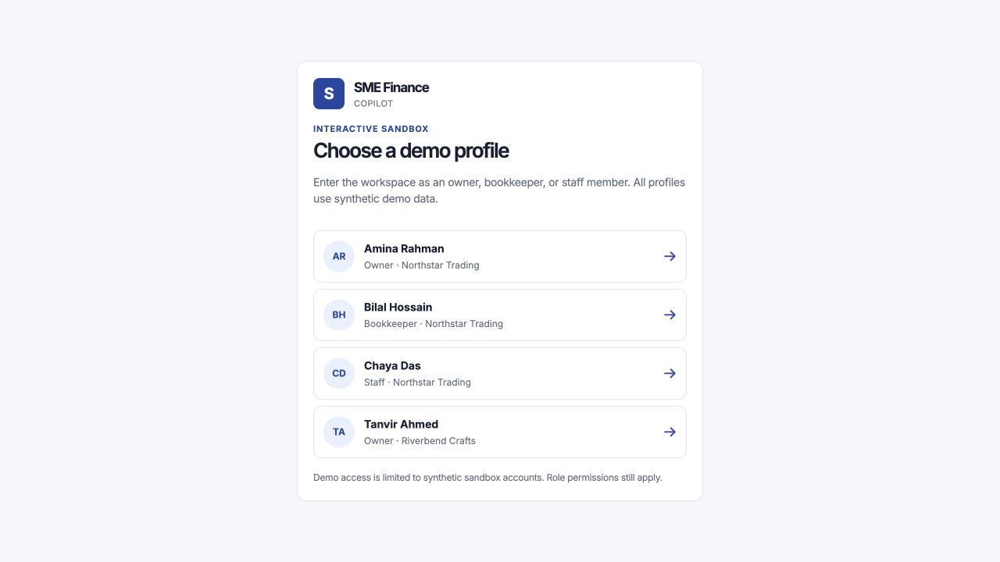
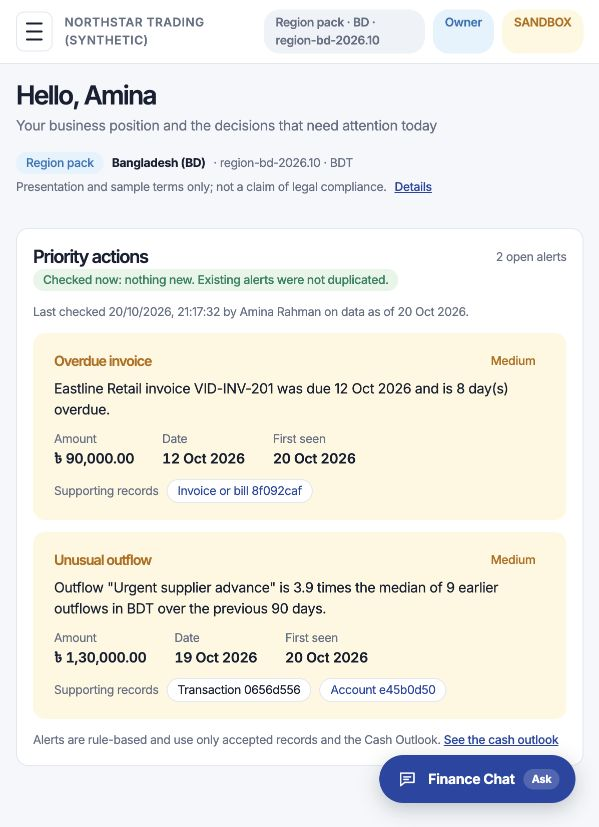
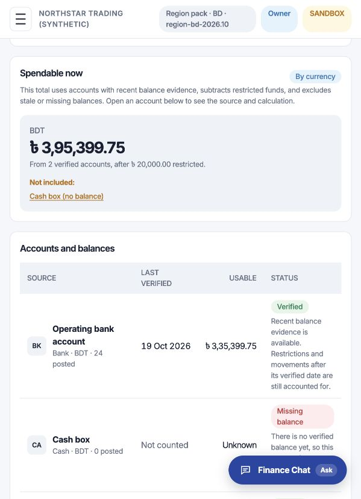
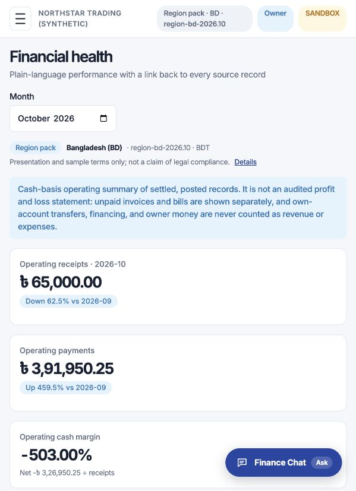
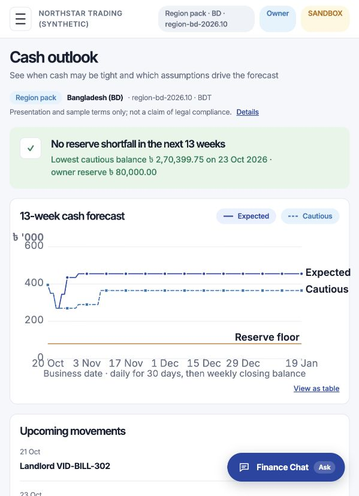
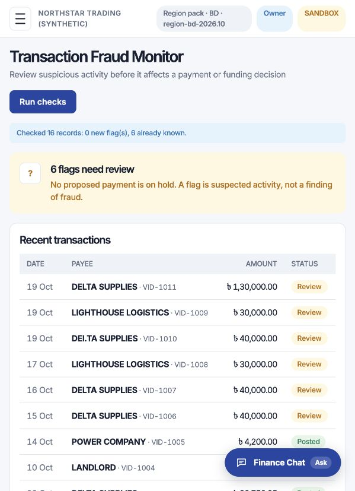
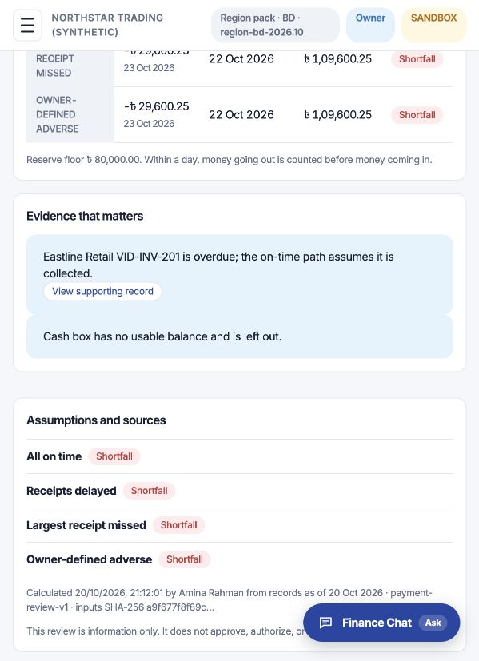
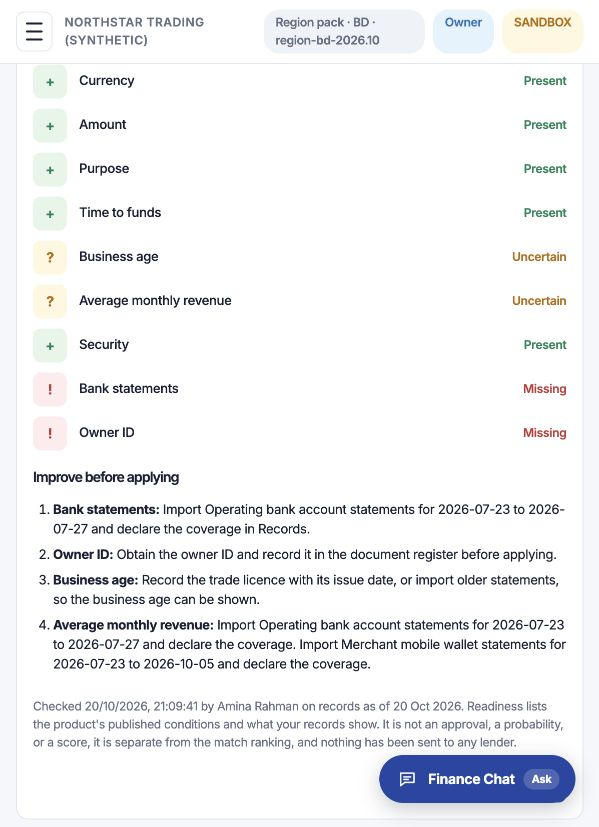
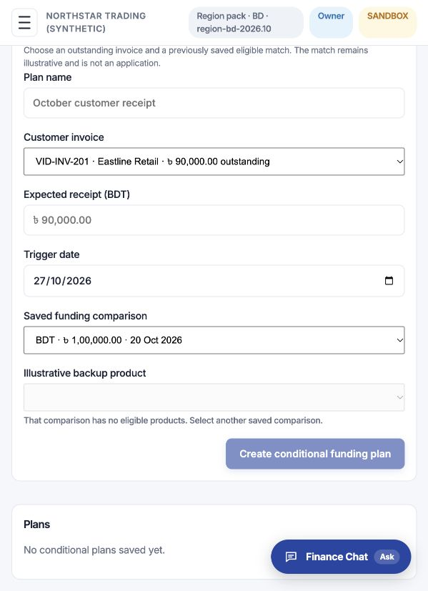

# CoinCaddy — LedgerLift SME Finance Copilot

**LedgerLift** is a finance copilot concept for small businesses. It brings records, cash position, forecasts, receivables, payment review, fraud signals, and financing readiness into one explainable workspace. Recommendations link back to source records; financial actions stay behind role permissions, approvals, and sandbox controls.

> This is a student prototype for demonstration. It uses synthetic data and mock integrations. It is not a bank connection, lender decision, audited accounting system, or production payment service.

## Try the live demo

- **Live app:** [https://coincaddy.vercel.app](https://coincaddy.vercel.app)
- **GitHub:** [Raihri/CoinCaddy](https://github.com/Raihri/CoinCaddy)
- **Previous live address:** [sme-copilot-ebon.vercel.app](https://sme-copilot-ebon.vercel.app) (kept as an alternate domain)

Choose a synthetic demo profile to enter the sandbox. Amina Rahman is the owner profile for Northstar Trading; Bilal Hossain is the bookkeeper; Chaya Das is staff. Role permissions apply to each profile.

The **hosted** Northstar demo is pre-populated with synthetic transactions, invoices, bills, balance anchors, a cash restriction, a matched account transfer, a saved cash forecast, a payment review, and fraud-monitor examples. You can explore these screens without entering records manually. Some actions intentionally remain blocked until a user with the right role approves them. The local seed command below creates the demo businesses, accounts, and users; it does not copy the hosted transaction history into your local database.

## Product features

- **Records and reconciliation:** Import/review transactions, inspect statement coverage and balance anchors, reconcile transfers, track account restrictions, and calculate spendable cash from verified evidence.
- **Financial Health:** Review categorized operating receipts and payments, net cash, margin, customer dues, and linked source records.
- **Cash Outlook:** Compare expected and cautious cash paths over 30 days and 13 weeks, check reserve breaches, and verify a saved calculation against its inputs.
- **Payment Review:** Test a proposed payment against four cash scenarios and a reserve floor; save the assumptions and supporting records.
- **Financing readiness:** Compare synthetic funding products, see eligibility conditions, and prepare an owner-reviewed application packet preview.
- **Conditional Funding:** Explore a plan only when product eligibility and evidence checks allow it.
- **Receivables Guardian:** Review overdue invoices and draft reminders. Sending is gated by verified contact details, role permissions, and approval controls.
- **Fraud Monitor:** Review rule-based signals such as duplicate-like transactions, unusual outflows, split payments, and lookalike payees. Alerts are leads for human review, not fraud determinations.
- **Finance Chat and audit:** Ask questions grounded in saved calculations; review proposals, approvals, blocked actions, and sandbox outcomes.

## Current demo screenshots

Captured from the deployed app on 20 October 2026. All business and transaction data shown is synthetic.

| Quick login | Overview and alerts |
| --- | --- |
|  |  |

| Records and spendable cash | Financial Health |
| --- | --- |
|  |  |

| Cash Outlook | Fraud Monitor |
| --- | --- |
|  |  |

| Payment Review | Funding Matches |
| --- | --- |
|  |  |

| Conditional Funding |
| --- |
|  |

## Technical documentation

- [System architecture](Architecture.md)
- [Technical documentation](Technical%20documentation.md)
- [Security self-assessment](Security%20self-assessment%20report.md)
- [Synthetic demo users](fixtures/demo_users.json)
- [Synthetic import files](fixtures/imports/)

## Run locally

### Prerequisites

- Docker with Docker Compose
- Python 3.12
- Node.js and npm

### Start the services

1. Create local configuration and start PostgreSQL:

   ```bash
   cp .env.example .env
   docker compose up -d
   ```

2. Install backend dependencies and prepare the database:

   ```bash
   cd backend
   python -m venv .venv
   source .venv/bin/activate       # Windows: .venv\Scripts\activate
   pip install -r requirements.txt
   alembic upgrade head
   python -m app.fixtures.seed
   ```

   The quick-login profile picker is disabled by default in `.env`. To use it for a local synthetic demo, set `DEMO_QUICK_LOGIN_ENABLED=true` in `.env` before starting the API. If the API is already running, restart it after changing the setting. Keep this option limited to a local sandbox. Otherwise, sign in with a synthetic user email from `fixtures/demo_users.json` and the local `DEMO_USER_PASSWORD` value from `.env`.

   To populate local transaction history, open **Records**, upload a synthetic CSV from `fixtures/imports/`, review the import, and post the accepted rows. The seed command does not import these files automatically.

3. Start the mock service and API in separate terminals. Run the first command from the repository root:

   ```bash
   backend/.venv/bin/python -m uvicorn mock_services.app:app --port 8100
   ```

   Start a new terminal from the repository root, then run:

   ```bash
   cd backend
   .venv/bin/python -m uvicorn app.main:app --port 8000
   ```

4. Start the frontend in another terminal:

   ```bash
   cd frontend
   npm install
   npm run dev
   ```

   Open [http://localhost:5173](http://localhost:5173) and choose a synthetic profile.

### Tests and health checks

From `backend/`, activate the virtual environment and run:

```bash
pytest -q
python -m app.modules.audit.verify
```

The test suite creates and migrates a separate database named after the development database with `_test` appended (for example, `smecopilot_test`). It refuses a test database name that does not end in `_test`; you can override it with `TEST_DATABASE_URL`. Tests do not use or reset the demo database. Health checks are available at `/api/health/live` and `/api/health/ready`. The mock service health endpoint is `http://127.0.0.1:8100/health`.

## Repository layout

| Path | Contents |
| --- | --- |
| `backend/` | FastAPI application, database models, migrations, domain services, and tests |
| `frontend/` | React, TypeScript, and Vite application |
| `mock_services/` | Local sandbox boundary for simulated actions |
| `fixtures/` | Synthetic users, scenario inputs, expected values, and import files |
| `ss/` | Current screenshots from the populated live demo |
| `storage/` | Private uploads created at runtime; excluded from Git |
