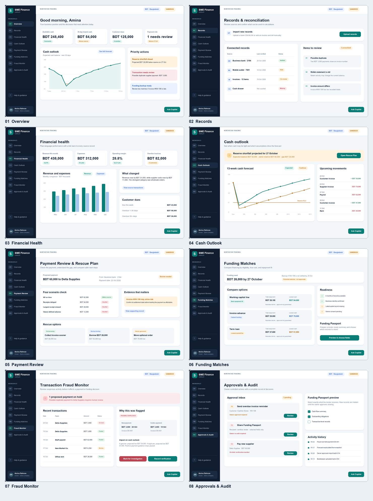

# SME Finance Copilot — project package

This folder contains a product requirements document, a proposed architecture, a build sequence, an honest status report, a feature/security matrix, and static screen mockups.

## Documents

| File | Purpose |
| --- | --- |
| [prd.md](prd.md) | Users, product scope, requirements, journeys, acceptance criteria, and screens |
| [architecture.md](architecture.md) | Data model, calculation and matching rules, AI boundaries, security, APIs, and tests |
| [phases.md](phases.md) | Competition demo path and later build phases with exit gates |
| [built_so_far.md](built_so_far.md) | What exists in this package and what remains unimplemented |
| [feature_security_matrix.md](feature_security_matrix.md) | Every feature, innovation flag, implementation approach, and built-in security |

## Mockups

1. [Overview](images/01-overview.png)
2. [Records](images/02-records.png)
3. [Financial Health](images/03-financial-health.png)
4. [Cash Outlook](images/04-cash-outlook.png)
5. [Payment Review](images/05-payment-review.png)
6. [Funding Matches](images/06-funding-matches.png)
7. [Fraud Monitor](images/07-fraud-monitor.png)
8. [Approvals & Audit](images/08-approvals-and-audit.png)

The screen images use illustrative synthetic BDT data. This package is a design and implementation plan, not evidence that the application, financial calculations, security controls, or integrations have been built.
