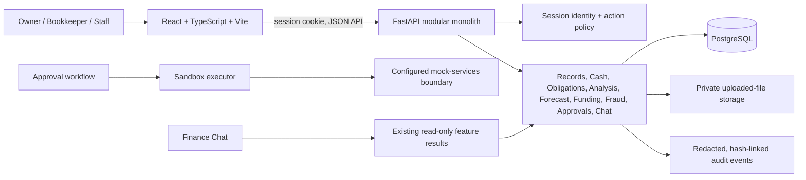

# CoinCaddy: Technical Documentation

## 1. Purpose and boundaries

CoinCaddy helps a small-business owner understand recorded cash, review upcoming obligations, model a proposed payment, and compare illustrative financing options. It brings statement imports, account reconciliation, receivables/payables, cash-basis financial summaries, cash forecasts, alerts, financing matches, fraud flags, and approval workflows into one workspace.

The application is a decision-support prototype. Financial Health is a cash-basis summary, not an audited profit-and-loss statement. Forecasts depend on declared and imported records. A fraud flag is a review signal, not a finding. A financing match is illustrative, not an offer or approval. The action adapters are designed to target a mock sandbox and are reported not to connect to a live bank, lender, or messaging provider. The deployed endpoint configuration has not been independently verified; the mock-only boundary is a release gate.

The application supports synthetic demo data and CSV/XLSX imports. It does not currently provide a live bank feed or a production lending integration.

## 2. System architecture

### Components

| Component | Implemented responsibility |
| --- | --- |
| `frontend/` | React/TypeScript single-page application, page routing, role-aware controls, CSV/XLSX upload and review screens, forecasts, reports, and approvals UI. Built with Vite. |
| `backend/app/main.py` | FastAPI application and registration of feature routers, CORS policy, and upload request-size middleware. |
| `backend/app/modules/` | Modular monolith: identity, records, cash reconstruction, obligations, Financial Health, outlook, alerts, payment review, funding, readiness, rescue, guardian, fraud, approvals, executor, passport, region packs, chat, and audit. |
| PostgreSQL | Financial records, business memberships, imports, frozen calculation inputs/results, approvals, and audit events. Schema changes are applied through Alembic migrations in `backend/migrations/versions/`. |
| Private file storage | Retains uploaded originals outside public frontend assets. Location is configured by `STORAGE_DIR` or defaults to the application's private storage path. |
| Mock-services boundary | Designed to receive sandbox action requests through `MOCK_SERVICES_URL`. The adapters reportedly send no bank/lender credentials and redact returned/logged information. Verify the configured URL, host/path allowlist, and network egress for each deployment before release. |
| Health routes | `/api/health/live` reports process health; `/api/health/ready` checks database/schema and mock-service boundary readiness. |

The hosted project has used a Vercel frontend and Render API/database. Deployment settings are maintained by those services rather than fully described by deployment manifests in this repository. This document does not claim a fresh production health check or independent verification of production configuration.

### Request and data flow

1. A user signs in. The API resolves an opaque session token to a user, then resolves business membership and role from the database.
2. Imports are parsed and normalized into a reviewable staging batch. Staged rows are not ledger facts. An owner or bookkeeper reviews the rows and posts accepted rows.
3. Feature services load only records belonging to the authorized business. Calculations use integer minor units and currency codes.
4. Forecasts and decision reports store calculation version, frozen inputs, inputs hash, assumptions, outputs, and source links so a saved result can be checked against its original inputs.
5. A proposed external-style action remains a proposal until an owner approves it. Release checks approval gates; the executor checks again and is designed to send only to the configured mock-service endpoint. Confirm the deployed endpoint and egress restrictions before any demo.
6. Important mutations, denials, and decisions append a redacted audit event to a SHA-256 linked chain.

## 3. Main modules and data

| Module | Function |
| --- | --- |
| Records | Import CSV/XLSX, map columns, preview rejected rows and duplicate candidates, review, post, and inspect source lineage. |
| Cash & Reconciliation | Balance anchors, statement coverage intervals, period residuals, freshness, restricted funds, usable cash, and suggested own-account transfer pairs. |
| Receivables & Payables | Invoices/bills, partial settlements, reversals, disputes, due dates, and outstanding amounts. An overpayment beyond outstanding is rejected. |
| Financial Health | Monthly operating receipts, payments, net operating cash, categories, cash margin, six-month trend, dues, coverage status, and transaction drill-down. |
| Cash Outlook & Alerts | Saved 30-day daily and 13-week forecast; expected/cautious paths, reserve breaches, evidence notes, upcoming movements, and alerts. |
| Payment Review & Rescue | Four-path payment review, decision-impact evidence queue, saved report, and non-borrowing/illustrative funding scenarios. A review never pays. |
| Funding Matches & Readiness | Locale-aware illustrative product catalogue, eligibility exclusions, repayment schedules, forecast impact, and missing-document readiness checks. |
| Receivables Guardian & Conditional Funding | Draft reminders for verified contacts; receipt-trigger and backup-financing scenarios. Decisions remain owner-reviewed. |
| Fraud Monitor | Rule-based suspected duplicate, unusual amount, split payment, lookalike payee, changed destination, and settlement-mismatch flags. |
| Approvals, Executor & Funding Passport | Payload-bound action proposals, owner decisions, T2/T3 gates, sandbox logs, and an owner-selected disclosure packet snapshot. |
| Finance Chat | Routes a question to one existing read-only calculation/report. The chat has no ledger, approval, payment, or sharing tools. |
| Region Packs | Currency, formatting, import templates, regional catalogue selection and region-specific presentation settings. |

Core records are business-scoped and include businesses, users, memberships, cash accounts, statement imports and staged rows, ledger transactions, balance anchors, coverage periods, restrictions, transfer links, obligations and allocations, classifications, forecast and review snapshots, funding catalogue versions, fraud cases, action proposals/decisions, passport snapshots, chat exchanges, and audit events.

**Money representation:** signed integer minor units plus ISO currency. Values in different currencies are not added together.
**Dates:** business-local dates are distinct from UTC event timestamps. Business timezone comes from the business profile.
**Lineage:** posted transactions retain import/source identifiers and row references; calculation outputs link back to source records where supported.
**Tenant boundary:** API queries are explicitly filtered using the business ID derived from authenticated membership. PostgreSQL row-level security is not configured as a second tenant isolation layer.

## 4. Core algorithms

### 4.1 Import, normalization, and posting

1. The upload parser accepts CSV and `.xlsx`, checks content against the extension, and parses values rather than executing spreadsheet content.
2. Current parser limits are 2 MiB, 5,000 data rows, 30 columns, 500 characters per cell, 200 XLSX ZIP entries, and 25 MiB expanded workbook content. Legacy/encrypted `.xls`, encrypted workbooks, macros, formulas, suspicious compression, ambiguous multi-sheet workbooks, and malformed/ambiguous files are rejected.
3. The user maps date, amount or debit/credit, description, counterparty, reference, and currency columns. Normalization checks dates, amount precision, currency agreement, formulas, malformed text, and configured supported bounds. Ambiguous date formats require a choice.
4. Rows with errors remain rejected; possible duplicates are marked for review, not silently treated as confirmed duplicates. Users can inspect staged rows and select accepted rows.
5. Posting runs server-side with business/account scope and transactional/idempotency checks. Successful rows become canonical transactions with import lineage; retries must not double-post the same import operation.

### 4.2 Reconciliation and usable cash

A balance anchor is an account balance at the end of its recorded date. For consecutive anchors, the engine computes:

`residual = opening balance + sum(posted movements in (opening date, closing date]] - closing balance`

A period is arithmetically balanced only when the residual is zero. It is complete only when declared source coverage spans every date after the opening anchor through the closing anchor. Matching balances alone do not prove source coverage.

The most recent anchor is extended only through contiguous declared coverage. Transactions after the verified-through date are shown as uncovered movements and are not included in verified cash. `usable cash = verified balance - active restrictions`. A balance is fresh when its evidence-through date is no more than two days old. Missing and stale accounts are excluded from “Spendable now”; they are surfaced separately. A new anchor and complete coverage are needed to verify them again.

Transfer suggestions compare opposite-signed transactions in same-currency business accounts within the matching window. They are suggestions only. A user must explicitly link a pair; a one-sided declared transfer stays unmatched and is shown as unresolved evidence.

### 4.3 Financial Health

The `fh-v1` monthly summary groups posted, classified transactions by month and currency. Operating receipts and payments are totalled separately; net operating cash is receipts minus payments. The displayed cash margin is net operating cash divided by operating receipts, returned in basis points with integer rounding. Own-account transfers, financing, owner contributions/drawings, and other non-operating items are excluded from operating totals. Unclassified posted records are shown, with their source IDs, and make the month incomplete. This is a cash movement summary, not accrual accounting or an audited P&L.

### 4.4 Cash Outlook and alerts

The `outlook-v1` engine freezes records and computes 91 days (13 weeks) per account and currency. It also exposes the first 30 days daily. Currency totals remain separate.

- **Expected:** known usable balance and posted uncovered movements; undisputed invoices on their due date (overdue invoices are assumed collected in seven days and marked uncertain); bills on the due date or tomorrow if overdue.
- **Cautious:** a stale account contributes no positive opening cash (a negative balance remains a risk); non-overdue receipts are delayed 14 days; overdue and disputed receipts are excluded; bills still go out.
- Restrictions are released on the day after their declared end date. No future own-account transfer is assumed.
- The engine stores the inputs, calculation version, and canonical SHA-256 digest with the output. “Verify figures” compares the stored calculation with its frozen inputs. Changed underlying records mark a saved result out of date until recalculated.
- Alerts describe a forecast or record condition and link to supporting records. They are not payment instructions.

### 4.5 Payment Review

The `payment-review-v1` engine tests one proposed payment, account, date, amount, and optional linked bill against four paths using one frozen Cash Outlook input:

1. All on time.
2. Receipts delayed 14 days; overdue receipts omitted.
3. The largest eligible incoming receipt omitted.
4. Owner-defined adverse case: receipt delay, receipt haircut, and/or additional dated outflow.

Currencies are never mixed. Within a day, outflows are applied before inflows. A linked bill event is replaced by the proposal so the payment is not counted twice; a partial payment leaves the unpaid remainder as an event. Each path reports its low point, reserve breach/shortfall, assumptions, and record links. A known reserve breach is reported even if other evidence is incomplete. Without a known breach, missing/stale balances, missing reserve, unmatched transfer, or disputed linked bill can prevent a positive “within reserve” result. The result is analysis only and does not authorize a payment.

The evidence queue prioritizes unresolved records that could change this specific review. Rescue scenarios compare collection, permitted deferral, illustrative financing, and combinations without mutating the ledger.

### 4.6 Financing match and conditional plan

The `funding-v1` matcher first applies hard eligibility checks from a versioned sample catalogue: jurisdiction, currency, requested amount, declared months trading, average monthly classified operating receipts from the previous 90 days, purpose, available security, declared documents, and typical funding time. It keeps every exclusion reason and never ranks an ineligible product.

For eligible products, integer arithmetic calculates processing fees, interest/fees, total repayment, total cost, and dated repayments. It adds illustrative net proceeds and repayments to a copy of the Cash Outlook inputs, then ranks on cautious reserve fit, cautious low cash, total cost, funding time, and stable product ID. Catalogue terms are illustrative; the app does not send business data to a lender.

Conditional Funding replaces the planned portion of a selected invoice with an owner-declared receipt-date scenario. A missed receipt may trigger a recalculated no-borrow or illustrative backup case. The plan does not apply for finance or automatically accept a backup.

### 4.7 Fraud review and sandbox actions

Fraud rules compare known records and payee histories. Current rules identify likely duplicate payments, unusually large payee payments with sufficient history, clustered near-limit payments, lookalike payee names, changed bank/wallet destinations, and payment records lacking a corresponding settlement movement after configured delays. Rules produce evidence-backed candidates and suspected flags; a reviewer may confirm, clear, or defer with an explanation. These rules can produce false positives and cannot prove intent.

For supported actions (invoice reminder, supplier payment, financing application, and Funding Passport share), the workflow stores an exact proposal payload and hash. These controls bind the approval to the proposal but do not make the underlying business decision infallible. It binds business, action kind, tier, proposer, policy version, expiry, and payload. Approval, release, and execution re-check the relevant conditions. The executor is designed to use a fixed adapter targeting the configured mock-services boundary and sends an idempotency key. Execution logs retain redacted request/result summaries. The project assessment reports that no adapter connects to a real provider; deployment configuration and network egress still require verification before release.

### 4.8 Finance Chat

A deterministic planner maps a question to at most one read-only tool: Financial Health, Cash Outlook, Payment Review, or Funding Matches. Each tool checks its feature-specific permission and reads a saved result; chat does not perform arithmetic or write records. Record text is treated as untrusted, cleaned, shortened, and scanned for instruction-like content. The optional language model only drafts short wording from computed facts, under placeholder validation; template responses are the default. Chat cannot approve, pay, send, share, or change anything.

## 5. Security design

- Authentication is a server-managed session cookie. The raw random session token is returned only in an HttpOnly, SameSite=Strict cookie; the database stores its SHA-256 hash. Sessions expire after eight hours and logout revokes them. The `Secure` cookie attribute is enabled outside development.
- Authorization is server-side and deny-by-default. Every business route uses a required action. Business membership and role are resolved on the server; a user outside a business receives a not-found response. UI hiding is only presentation, not enforcement.
- Request models reject unexpected fields on sensitive workflows and validate amounts, dates, channels, destinations, IDs, and text. CORS origins are configuration-based; methods are limited to GET/POST/PATCH. Upload request size is bounded before multipart handling.
- Imported file parsing enforces the limits listed above and rejects formulas/macros/encrypted or suspicious workbook content. Staging separates untrusted data from posted ledger records.
- Proposal approval is bound to a payload digest and expiry; this is application-level integrity checking, not a claim that the database or proposal history is immutable against a privileged administrator. T2 reminders require explicit owner approval. T3 supplier payments, application submissions, and packet shares require owner approval, password re-authentication, documented verification, and a second reviewer different from the proposer. Owner-only release and sandbox execution perform freshness/hold checks.
- Payee account identifiers are not retained as plaintext by the destination registry; the app stores a keyed HMAC and last four digits. Sandbox requests and audit details are redacted. Reminder message content is hashed and length-recorded rather than written to execution logs.
- Audit events include actor, role, action, outcome, target, and redacted details. A serialized append computes a SHA-256 chain. The verifier detects changes to existing chain contents; this is tamper-evident, not immutable against a database administrator who can rewrite the whole chain.
- No configured Postgres row-level security policy was found. Tenant isolation currently depends on authenticated business context and business-scoped SQL queries; this requires continued cross-business authorization testing.

## 6. Verification evidence

Verified locally on 20 October 2026:

| Verification | Result |
| --- | --- |
| Backend automated tests: `cd backend && .venv/bin/python -m pytest -q --tb=short` | **514 passed**. Runtime: 50.84 s. The run emitted 2,107 dependency deprecation warnings; no test failures. |
| Frontend production build: `cd frontend && npm run build` | **Passed**: TypeScript project build and Vite production bundle completed. |

The test suite contains focused coverage for authorization, record imports, cash reconstruction, obligations, Financial Health, outlook, alerts, Payment Review, funding, fraud, approval workflow, sandbox executor, audit, Funding Passport, chat, region packs, and conditional funding. See `backend/tests/`.

These results establish that the included automated tests and build passed at the time above. They are not a penetration test, independent security audit, dependency vulnerability scan, external integration test, or evidence that a deployed instance is currently healthy. The audit chain verifier is available as `cd backend && .venv/bin/python -m app.modules.audit.verify`; it requires a configured database and was not run as part of the checks above. The verifier does not provide independent immutability against an administrator able to rewrite the database and recompute the chain.

## 7. Security status, known gaps, and release gates

The following items are not represented as completed fixes. They are required verification or remediation tasks based on the current assessment:

| Priority | Gap / risk | Required action before the relevant release |
| --- | --- | --- |
| **P0 — demo release gate** | The deployed `MOCK_SERVICES_URL`, demo quick-login, TLS, CORS, and network egress have not been independently verified. | Validate environment settings; allowlist mock-service hosts and paths; fail closed on invalid targets; restrict egress; prove no action can reach a live provider. Keep quick login limited to synthetic users. |
| **P0 — data isolation gate** | Tenant isolation relies on business-scoped application queries; PostgreSQL RLS is not configured. | Review every tenant-owned query, export, nested resource, chat tool, and background task. Test cross-business reads and writes. Consider RLS as defense in depth after testing tenant context. |
| **P1 — before real financial data** | No MFA at sign-in; session/account compromise remains a risk. | Add MFA for owners and privileged accounts, login rate limiting, suspicious-login monitoring, and tested session/device revocation. |
| **P1 — before real file uploads** | Malware scanning is not evidenced. Structural file validation does not prove a file is harmless. | Add malware scanning, isolated parsing, dependency patching, and hostile-file tests. |
| **P1 — before production** | No independent penetration test or dependency vulnerability scan is supplied. | Commission independent testing, run dependency and license scans, triage findings, and document remediation. |
| **P1 — before production** | Audit events are hash-linked in the same database; a privileged database operator could rewrite and re-hash the chain. | Export signed checkpoints/events to independently controlled immutable storage and alert on verification failures. |
| **P1 — before production** | Production secrets, encryption-at-rest, backup restoration, retention, and infrastructure permissions are not independently verified. | Review secret rotation, encryption, least privilege, retention/deletion, backup access, and perform a restore test. |
| **P1 — before enabling AI with real data** | Optional model calls may process user questions and derived financial facts through a third-party provider. | Keep template mode for public demos. Before enabling real data, document provider, fields sent, purpose, retention, residency, access, contractual terms, and user notice. |
| **P1 — before fraud-effectiveness claims** | Fraud rules are heuristics; false-positive/false-negative rates and adversarial robustness are not independently validated. | Evaluate representative and adversarial cases, define thresholds and human review, and avoid claiming fraud certainty. |
| **P2 — policy decision** | T2 reminder release does not require a second reviewer under the current policy. | Document why single-reviewer release is proportionate for a mock reminder. Reassess before any live messaging or higher-impact action. |

P0 means a release-blocking gate for the stated deployment; P1 means high-priority work before real financial data or live integrations; P2 means a policy decision or hardening task. These are recommended priorities, not findings that a vulnerability has been exploited.

**Current release posture:** conditionally suitable for a synthetic-data competition demonstration only after the deployment configuration and mock-only boundary are verified. Not assessed as production-ready for real financial data or live action execution.

## 8. Local run and demo boundary

Follow the current [README.md](README.md) and `.env.example` for local setup. Run migrations with Alembic before starting the API. Use synthetic fixtures and the mock-services process for a demo. Passwordless quick login is controlled by `DEMO_QUICK_LOGIN_ENABLED` and is reported to default off in application settings; if enabled, it must select only users marked synthetic. Verify this setting in the actual deployment. Do not load real customer records into the public demo environment.

## 9. Repository references

- API and module registration: `backend/app/main.py`
- Identity and role policy: `backend/app/modules/identity/`
- Calculations: `backend/app/modules/{cash,health_summary,outlook,payment_review,funding,fraud,conditional_funding}/`
- Proposals and sandbox boundary: `backend/app/modules/{approvals,executor}/`
- Audit chain: `backend/app/modules/audit/`
- Automated tests: `backend/tests/`
