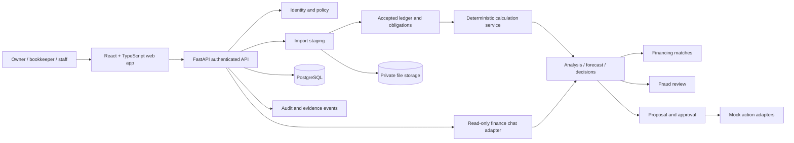

# SME Finance Copilot — Technical Documentation

**Version:** 1.0 · **Date:** 20 October 2026 · **Status:** Design specification, not an implementation report  
**Competition topic:** E — financing-option matching, cash-flow management with alerts, and business financial analysis  
**Evidence reviewed:** `prd.md`, `architecture.md`, `phases.md`, `feature_security_matrix.md`, `design.md`, `built_so_far.md`, and eight static mockups. The project folder has no application source code, deployed service, migrations, automated test output, or sandbox operation logs as of this review.

## 1. Scope and system goal

The proposed product helps a small-business owner understand accepted financial records, anticipate a cash shortfall, test a proposed payment, and compare a non-borrowing response with illustrative financing. It links conclusions to source records and asks for verification when missing or disputed evidence could change a decision.

The competition prototype is designed for **synthetic business data, illustrative finance products, and mock bank/lender services**. A match is not a lender offer; a fraud flag is not a fraud finding; a cash forecast is not a guarantee. No real payment, application, or data disclosure is authorized by the design documents.

## 2. Proposed architecture

**Reference stack:** React/TypeScript client; Python/FastAPI modular monolith; PostgreSQL; private object storage; one background worker; mock bank and lender adapters. These are proposed choices, not installed dependencies. A modular monolith keeps authorization, calculations, and transaction boundaries inspectable for the prototype.

### Trust boundaries

1. Browser input and uploaded files are untrusted. Server-side validation decides what may enter staging.
2. Staged records are not accepted financial facts. Only an authorized, idempotent commit moves reviewed rows into the canonical ledger.
3. The calculation service reads accepted, versioned records. The AI may explain outputs through narrow read-only tools; it cannot calculate authoritative money values or change records.
4. Proposals and approvals are separate from action execution. The executor rechecks policy, payload integrity, expiry, and fraud holds before a mock action.
5. Every business-scoped read and write derives business identity from authenticated membership, including workers and exports.

## 3. Modules and responsibilities

| Module | Owns | Main output |
| --- | --- | --- |
| Identity and policy | Memberships, roles, action tiers | Allow/deny decision tied to authenticated user and business |
| Import | Upload quarantine, parser, staging, mapping, duplicate candidates | Reviewed commit manifest |
| Ledger and reconciliation | Accounts, transactions, transfers, anchors, coverage | Account-specific usable cash and quality status |
| Obligations | Receivables, payables, allocations, reversals | Outstanding dues and dated obligations |
| Analysis | Cash-basis operating totals and evidence | Financial Health figures |
| Cash planning | Frozen snapshots, scenario paths, reserve checks | 30-day and 13-week outlook |
| Decisions | Payment Review, evidence queue, rescue and conditional plans | Versioned reports and proposals |
| Matching | Product versions, eligibility, repayment schedules | Ranked illustrative matches with reasons |
| Fraud monitor | Rule hits, holds, reviewer decisions | Suspected-activity cases and bounded cash outcomes |
| Approvals and sandbox | Immutable proposal payload, owner consent, mock execution | Approved/rejected outcome and operation log |
| Audit and AI adapter | Event history; narrow read-only query tools | Traceable evidence and explanations |

## 4. Data contracts

- **Money:** signed integer minor units plus ISO currency code. Do not use binary floating point for stored amounts or comparisons.
- **Time:** UTC event timestamp and separate business-local date/timezone. Forecast ordering must state whether same-day inflows are available before a payment; if unknown, stress with outflows first or return insufficient timing evidence.
- **Scope:** every financial entity carries a `business_id`; account and source foreign keys must remain within that business.
- **Lineage:** accepted transactions retain source file/row ID, parser and mapping version, review decision, and correction/reversal chain.
- **Snapshots:** calculations retain input IDs/revisions, calculation version, cutoff date, reserve schedule, assumptions, and output.
- **Idempotency:** imports and sandbox actions use a business-scoped idempotency key and immutable request digest.
- **States:** missing, stale, restricted, disputed, and estimated data are explicit states rather than silently usable cash.

Core entities: Business, Membership, CashAccount, SourceRegistry, BalanceAnchor, CoverageInterval, ImportBatch, StagedRow, ReviewDecision, CashTransaction, TransferGroup, Obligation, Allocation, CalculationSnapshot, ForecastRun, PaymentReview, FinancingProductVersion, MatchResult, FraudCase, ActionProposal, Approval, SandboxExecution, AuditEvent.

## 5. Core algorithms

### 5.1 Import and posting

1. Register source, account, currency, covered period, and uploader permission.
2. Quarantine the file; enforce type, size, row-count, and decompression limits. Reject executable spreadsheet content, encrypted workbooks, and ambiguous amounts/dates.
3. Parse to staged rows; show mapping errors, overlaps, and duplicate candidates. A similar-looking purchase is not automatically a duplicate.
4. An authorized reviewer selects rows and commits a manifest. In one database transaction, verify batch revision and idempotency key, post canonical movements and lineage, append an audit/outbox event, and mark the batch committed.
5. Retrying the same commit returns its prior result without posting again.

### 5.2 Trusted cash and Financial Health

For one account and reconciled period:

`reconciliation residual = opening anchor + accepted signed movements - closing anchor`

A zero residual verifies arithmetic for that period only. It does not prove complete coverage or current cash. Usable cash excludes restricted funds and cannot borrow cash from another account unless a feasible dated transfer is represented.

The first Financial Health view is a **cash-basis operating summary**: settled operating receipts minus settled operating payments. It excludes own-account transfers and financing proceeds from revenue. Unpaid receivables and payables appear separately. Every displayed total must expose contributing source IDs or an unavailable-evidence state.

### 5.3 Cash Outlook and alerts

For each account, currency, scenario, and day `t`:

`closing_cash(t) = eligible_opening_cash + eligible_inflows(≤t) - required_outflows(≤t)`

Run a 30-day daily path and a 13-week weekly rollup from the same frozen snapshot. Expected and cautious paths distinguish confirmed cash from uncertain customer receipts. A reserve alert records first breach date, amount below reserve, and causal input IDs. Alert de-duplication uses business, rule, snapshot/version, and triggering entity.

### 5.4 Four-scenario Payment Review

Input: proposed amount, date, funding account, reserve schedule, and optional linked payable. Evaluate the same snapshot in four paths: (1) on time; (2) receipts delayed; (3) largest eligible receipt missed; (4) owner-defined adverse case. Replace a linked payable projection with the proposed payment so it is counted once.

For every path, output minimum cash, first reserve-breach date, shortfall, assumptions, and source links. Decision logic:

1. A known breach returns **Reserve shortfall**, even if some evidence is incomplete; show the evidence problem too.
2. Otherwise, material missing balance, required cost, timing, or disputed movement returns **More information needed**.
3. Only sufficiently supported paths that remain above the reserve return **Within reserve under stated assumptions**.

The result is an analysis report, not payment authorization. The decision-impact queue ranks unresolved records by whether plausible values could change this specific result.

### 5.5 Rescue Plan and financing matching

The Rescue Plan re-runs the frozen forecast for a small set of options: collect a receivable, move a discretionary cost with documented permission, use illustrative financing, or combine options. Compare lowest cash, timing, remaining shortfall, financing cost, and unverified dependencies. The simulator does not mutate the ledger.

Matching first applies hard eligibility filters to a **versioned** catalogue: jurisdiction, currency, business age/revenue, amount, purpose, security, documents, and time to funds. Eligible products receive a transparent total repayment calculation from their recorded terms. Insert their repayment events into the cash path before ranking on repayment fit, timing, cost, and readiness. Show exclusion reasons; never label an illustrative match an approved offer.

### 5.6 Fraud-aware cash and conditional funding

Versioned rules may flag duplicate payment candidates, split payments near a limit, unusual payee amount, lookalike payees, changed destination details, and “paid” invoices without settlement. Store compared record IDs and rule version. A material unresolved candidate shows bounded cash paths and holds an affected proposed sandbox payment until an authorized reviewer records a reasoned decision. Original records remain intact.

A Conditional Funding Plan follows: `awaiting receipt → verified settlement OR trigger missed → forecast recalculated → owner reviews backup proposal → approved mock submission`. Only accepted settlement evidence closes the receipt branch. A missed trigger may prepare a draft, never auto-apply.

## 6. Security design summary

The API enforces owner/bookkeeper/staff permissions and action tiers; the AI has no privileged credentials. T0 permits business-scoped analysis; T1 permits internal drafts; T2 requires explicit owner approval for low-impact mock sends; T3 requires re-authentication, documented verification, and explicit approval for sensitive mock actions. The executor rechecks the exact approved payload and any hold. Details and current implementation status are in `security_self_assessment.md`.

Private storage, transport encryption, scoped download links, secret management, redacted logs, and backup protection are required for any deployment. PostgreSQL row-level security is a possible second enforcement layer, but it must run under a non-bypass application role with verified business context; it does not replace server authorization.

## 7. Proposed API boundary

| Operation | Required check |
| --- | --- |
| Preview/commit import | Membership, role, source/account scope, revision, idempotency |
| Read analysis/forecast | Membership, business scope, snapshot and evidence visibility |
| Run Payment Review | Named account/currency, allowed snapshot, input validation |
| List financing matches | Catalogue version, illustrative status, no implicit disclosure |
| Review fraud case | Reviewer role, case revision, reason |
| Approve proposal | Owner role, action tier, exact immutable payload, freshness |
| Execute mock action | Recheck approval, scope, payload hash, expiry, fraud hold, retry key |
| Export report/passport | Owner consent, selected fields, recipient, expiry, scoped link |

These routes are contracts to implement; there are **no verified live endpoints** in the reviewed folder.

## 8. Verification plan and evidence

| Check | Expected proof | Current status |
| --- | --- | --- |
| Financial fixture arithmetic | Independent expected values match analysis, forecast, and all four payment paths | Not run; no code |
| Import retry | Same upload/commit cannot double post | Not run; no code |
| Data quality | Stale anchor, missing period, unmatched transfer, and disputed payment cannot be silently treated as cash | Not run; no code |
| Matching | Ineligible product excluded; repayments change minimum cash | Not run; no code |
| Business isolation | Changed IDs cannot expose another business through API, worker, or export | Not run; no code |
| Permission tiers | Staff action denied; owner approval and payload check enforced | Not run; no code |
| Fraud hold | Suspicious proposed mock payment blocked until reasoned review | Not run; no code |
| Prompt injection | Invoice text cannot change policy, calculations, or tool permissions | Not run; no code |
| Sandbox evidence | Timestamped, redacted denied/approved/result logs | Not available |

The implementation team should attach repository commit, test command/output, fixture IDs, and redacted sandbox log IDs to each completed check. Static mockups are design evidence only.

## 9. Deployment status and required handoff

No runnable package, deployment instructions, environment configuration, or GitHub repository link was present at review. Before submission, the source-code package needs an actual README with install/start commands, migrations, fixture load, mock-service configuration, test commands, and a reproducible deployment target. Do not substitute this design document for deployment proof.

## 10. Source references

- Project specifications: `prd.md`, `architecture.md`, `phases.md`, `feature_security_matrix.md`, `design.md`.
- [OWASP API Security Top 10 (2023)](https://api-security.owasp.org/editions/2023/en/0x00-header/).
- [OWASP File Upload Cheat Sheet](https://cheatsheetseries.owasp.org/cheatsheets/File_Upload_Cheat_Sheet.html).
- [OWASP LLM Prompt Injection guidance](https://genai.owasp.org/llmrisk/llm01-prompt-injection/).
- [PostgreSQL row-level security documentation](https://www.postgresql.org/docs/current/ddl-rowsecurity.html).
